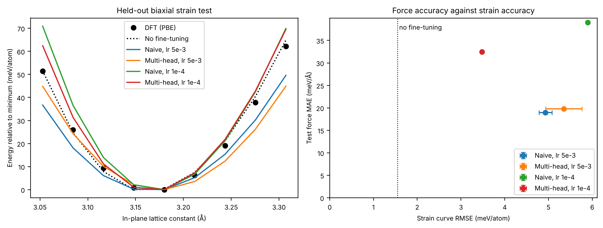

# Fine-Tuning MACE-MP-0 for Monolayer MoS₂

Fine-tuning the MACE-MP-0 foundation model on new PBE data for monolayer MoS₂, compared with the model before fine-tuning and with a MACE model trained from scratch.

Hamdan Ashfaq · PhD student, Computational Science, San Diego State University and UC Irvine


## Summary

* 157 DFT calculations (GPAW, PBE): 119 pristine monolayer cells (strained, rattled, and MD snapshots at 300 to 900 K) and 38 cells with a sulfur vacancy.
* Fine-tuning on 70 structures lowers the test force error from 244 to 19 meV/Å and the energy error from 9.7 to 0.8 meV/atom. The test set includes a full 600 K MD run that was kept out of training.
* A model trained from scratch on the same data reaches 21 meV/Å. Fine-tuning is better at every training set size and varies less between seeds.
* No model trained only on pristine cells handles vacancies. Adding 26 vacancy structures lowers the vacancy error from 301 to 39 meV/Å.
* Fine-tuning makes the strain curve too soft. Multi-head fine-tuning with Materials Project replay data only helps at a low learning rate, and then at the cost of force accuracy.
* The fine-tuned model runs stable MD on a 108-atom cell for 12 ps.

## Method

1. **Structures** ([`01_make_structures.py`](scripts/01_make_structures.py)). 2×2 supercells (12 atoms, about 14 Å of vacuum): 9 under biaxial strain from −4% to +4%, 50 with random strain and atomic displacements, and 60 MD snapshots at 300, 600 and 900 K from MACE-MP-0.
2. **DFT** ([`02_run_dft.py`](scripts/02_run_dft.py), [`dft.py`](scripts/dft.py)). GPAW, PBE, 400 eV plane-wave cutoff, 4×4×1 k-points, 0.05 eV Fermi-Dirac smearing. Convergence is checked in [`00_convergence.py`](scripts/00_convergence.py).
3. **Vacancies** ([`03_vacancy_data.py`](scripts/03_vacancy_data.py)). One S atom removed. 12 cells for testing, 26 for training.
4. **Split** ([`04_split_data.py`](scripts/04_split_data.py)). The strain series is held out. MD snapshots from one run are correlated, so the split is by trajectory: the test set is the whole 600 K run (20 snapshots) plus 10 rattled cells. 10 rattled cells are used for validation. The remaining 70 (30 rattled cells and the 300 K and 900 K runs) are for training, with 20 and 40 structure subsets for the learning curve.
5. **Training** ([`05_finetune.sh`](scripts/05_finetune.sh), [`06_train_from_scratch.sh`](scripts/06_train_from_scratch.sh)). MACE-MP-0 small (128 channels, L = 0, 6 Å cutoff) fine-tuned for 150 epochs. The baseline uses the same architecture from random weights for 300 epochs. Both ran on CPU in float64. The 70-structure models were trained with three seeds each.
6. **Multi-head fine-tuning** ([`09_multihead_finetune.sh`](scripts/09_multihead_finetune.sh)). Same settings, plus a second head trained on the 61 Materials Project structures that contain only Mo and S. This mode needs MACE-MP-0's own reference energies instead of averaged ones.
7. **Evaluation and MD** ([`07_evaluate.py`](scripts/07_evaluate.py), [`08_md_stability.py`](scripts/08_md_stability.py)).

## Results

All errors are on structures no model was trained on ([`results/metrics.json`](results/metrics.json)). Rows with 70 structures give the mean ± standard deviation over three seeds.

| Model | Training structures | Energy MAE (meV/atom) | Force MAE (meV/Å) | Force RMSE (meV/Å) | Vacancy force MAE (meV/Å) |
|---|---:|---:|---:|---:|---:|
| MACE-MP-0, no fine-tuning (zero-shot) | 0 | 9.7 | 244.3 | 325.1 | 383.9 |
| From scratch | 20 | 0.9 | 33.3 | 47.4 | 369.3 |
| From scratch | 40 | 0.8 | 26.2 | 37.3 | 321.3 |
| From scratch | 70 | 1.0 ± 0.3 | 21.2 ± 1.1 | 30.8 ± 1.7 | 254 ± 78 |
| Fine-tuned | 20 | 0.8 | 29.7 | 44.4 | 335.5 |
| Fine-tuned | 40 | 0.7 | 22.3 | 34.2 | 301.8 |
| Fine-tuned | 70 | 0.80 ± 0.05 | 18.9 ± 0.3 | 27.9 ± 0.5 | 301 ± 9 |
| Fine-tuned + vacancies | 70 + 26 | 0.6 | 20.5 | 28.9 | 39.5 |

The average DFT force component in the test set is 0.90 eV/Å.


* Before fine-tuning, MACE-MP-0 gets the force directions right but the magnitudes about 24% too small (slope 0.76 against DFT), the softening described by Deng et al.
* Fine-tuning beats training from scratch by 2 to 4 meV/Å at every training set size. At 70 structures the gap (18.9 ± 0.3 against 21.2 ± 1.1) is larger than the spread between seeds.
* No model trained only on pristine cells transfers to vacancies. The from-scratch models vary from 195 to 365 meV/Å depending on the seed, so neither approach is clearly better here. In a 2×2 cell the vacancy neighbors 3 of the 4 Mo atoms, which is far outside the training data.
* With 26 vacancy structures added, the vacancy error falls to 39 meV/Å while the pristine error stays near 20 meV/Å.

### Strain test


| | DFT | No fine-tuning | From scratch (70) | Fine-tuned (70) | Fine-tuned + vacancies |
|---|---:|---:|---:|---:|---:|
| Curve minimum (Å) | 3.168 | 3.164 | 3.170 | 3.165 | 3.172 |
| Curve RMSE (meV/atom) | | 1.5 | 1.6 | 5.0 | 5.9 |

All models find the minimum within 0.005 Å of DFT. MACE-MP-0 already gets this curve right, but the fine-tuned models come out too soft (50 meV/atom at +4% against 62 from DFT, and 37 at −4% against 51). The same happens for all three seeds, so fine-tuning on a small set loses some of what the foundation model knew. Training only covered ±3% strain mixed with atomic displacements.

### Can multi-head fine-tuning fix the softening?

Multi-head fine-tuning keeps training on part of the foundation model's data while fitting the new data. I tried it at the learning rate used above (5 × 10⁻³, three seeds) and at the 10⁻⁴ that MACE recommends for this mode (one seed each, with and without replay).



| Fine-tuning | Learning rate | Force MAE (meV/Å) | Strain curve RMSE (meV/atom) | Vacancy force MAE (meV/Å) |
|---|---:|---:|---:|---:|
| None | | 244.3 | 1.5 | 384 |
| Naive | 5 × 10⁻³ | 18.9 ± 0.3 | 4.9 ± 0.2 | 301 ± 9 |
| Multi-head | 5 × 10⁻³ | 19.8 ± 0.1 | 5.4 ± 0.4 | 309 ± 8 |
| Naive | 10⁻⁴ | 39.0 | 5.9 | 287 |
| Multi-head | 10⁻⁴ | 32.5 | 3.5 | 271 |

* At 5 × 10⁻³ the replay data makes no difference. The 70 MoS₂ structures dominate the shared weights.
* At 10⁻⁴ the replay data lowers the strain curve error from 5.9 to 3.5 meV/atom and the force error from 39 to 32 meV/Å. Both low learning rate models end up too stiff instead of too soft (about 70 meV/atom at +4% against 62 from DFT).
* No setting gets the force error near 19 meV/Å and keeps the strain curve of the model before fine-tuning. With this little data, fitting the new forces and keeping the pretrained elastic response pull against each other. Adding strained cells to training is the more direct fix.

### MD stability


| 108 atoms, fine-tuned model | |
|---|---|
| Mean temperature, last 5 ps | 300.3 K |
| Shortest Mo-S distance | 2.22 Å (2.43 Å at the start) |
| NVE energy drift | 3 × 10⁻⁵ meV/atom per ps |

The dip in temperature at the start comes from starting at a perfect lattice. The flat total energy in the NVE window shows the forces are consistent with the energies.

## Convergence and limitations

Measured on a rattled cell against 600 eV and 6×6×1 k-points ([`results/convergence.json`](results/convergence.json)):

| Setting | Energy difference (meV/atom) | Largest force difference (meV/Å) |
|---|---:|---:|
| 300 eV | 91.6 | 28.0 |
| 400 eV (used) | 16.3 | 7.0 |
| 500 eV | 3.5 | 0.4 |
| 3×3×1 k-points | 0.4 | 13.4 |
| 4×4×1 k-points (used) | 0.0 | 1.1 |

The 16 meV/atom offset at 400 eV is nearly constant across structures and cancels in relative energies. The force difference is below the model error.

* Small dataset of one material, all in 11 or 12 atom cells.
* No spin polarization, spin-orbit coupling or van der Waals correction.
* MACE-MP-0 was trained on VASP data, so part of its zero-shot error may come from differences between codes and PAW datasets rather than from the model.
* GPAW and MACE-MP-0 use different energy zero points, so model energies are shifted by a constant fitted on the training set. Vacancy cells have a different composition, so only their forces are compared.
* The strained cells are not relaxed, so the curve minimum is not the relaxed PBE lattice constant (about 3.18 Å).

Next: add strained and larger cells to training, and extend to other defects and twisted bilayers.

## Usage

```bash
git clone https://github.com/hamdanashfaq63/mos2-mace-finetuning.git
cd mos2-mace-finetuning
pip install -r requirements.txt
```

```python
from ase.build import mx2
from mace.calculators import MACECalculator

atoms = mx2("MoS2", "2H", a=3.18, vacuum=7.0).repeat((4, 4, 1))
atoms.calc = MACECalculator(model_paths="models/mos2_finetuned.model", device="cpu")
print(atoms.get_potential_energy())
```

To rerun everything from the repository root (GPAW also needs libxc, BLAS and its PAW datasets):

```bash
python scripts/00_convergence.py
python scripts/01_make_structures.py
python scripts/02_run_dft.py
python scripts/03_vacancy_data.py
python scripts/04_split_data.py
bash scripts/05_finetune.sh                                   # name, training file, seed, learning rate
bash scripts/05_finetune.sh mos2_finetuned_seed2 data/train.xyz 2
bash scripts/05_finetune.sh mos2_finetuned_seed3 data/train.xyz 3
bash scripts/05_finetune.sh mos2_finetuned_20 data/train_20.xyz
bash scripts/05_finetune.sh mos2_finetuned_40 data/train_40.xyz
bash scripts/05_finetune.sh mos2_finetuned_vacancy data/train_plus_vacancy.xyz
bash scripts/06_train_from_scratch.sh
bash scripts/06_train_from_scratch.sh mos2_from_scratch_seed2 data/train.xyz 2
bash scripts/06_train_from_scratch.sh mos2_from_scratch_seed3 data/train.xyz 3
bash scripts/06_train_from_scratch.sh mos2_from_scratch_20 data/train_20.xyz
bash scripts/06_train_from_scratch.sh mos2_from_scratch_40 data/train_40.xyz
bash scripts/09_multihead_finetune.sh
bash scripts/09_multihead_finetune.sh mos2_multihead_seed2 data/train.xyz 2
bash scripts/09_multihead_finetune.sh mos2_multihead_seed3 data/train.xyz 3
bash scripts/05_finetune.sh mos2_finetuned_lr1e-4 data/train.xyz 1 0.0001
bash scripts/09_multihead_finetune.sh mos2_multihead_lr1e-4 data/train.xyz 1 0.0001
python scripts/07_evaluate.py
python scripts/08_md_stability.py
```

Versions: GPAW 26.7 (PAW datasets 24.1), ASE 3.29, MACE 0.3.16, PyTorch 2.14.

## Repository layout

```
├── scripts/    structure generation, DFT, training, evaluation, MD
├── data/       structures and DFT labels (extended XYZ: REF_energy in eV, REF_forces in eV/Å)
├── models/     trained MACE models
└── results/    metrics, figures, convergence data, logs
```

## References

* I. Batatia, D. P. Kovács, G. N. C. Simm, C. Ortner and G. Csányi, "MACE: Higher order equivariant message passing neural networks for fast and accurate force fields," NeurIPS 2022.
* I. Batatia et al., "A foundation model for atomistic materials chemistry," arXiv:2401.00096.
* B. Deng et al., "Overcoming systematic softening in universal machine learning interatomic potentials by fine-tuning," arXiv:2405.07105.
* J. J. Mortensen et al., "GPAW: An open Python package for electronic structure calculations," J. Chem. Phys. 160, 092503 (2024).

## License

MIT. The DFT data in `data/` is free to reuse.
