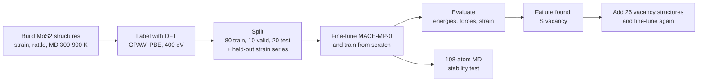
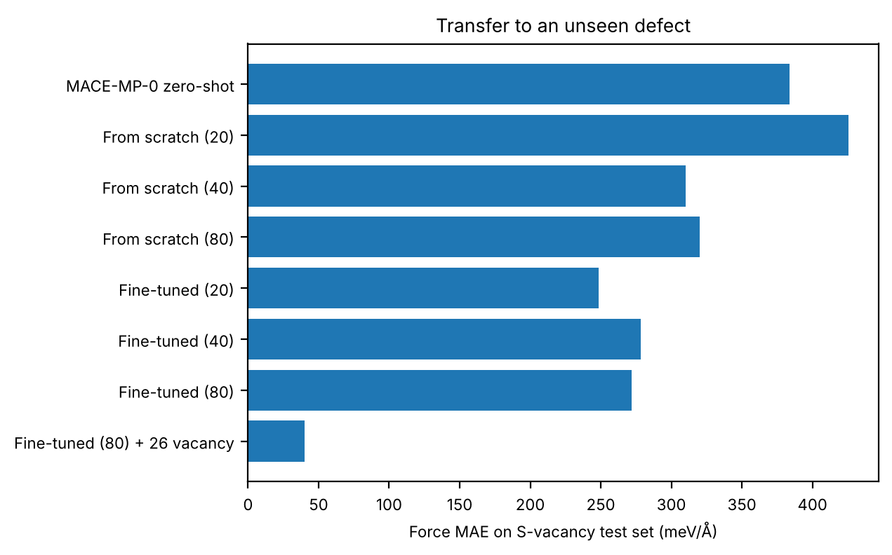

# Fine-Tuning a Foundation MLIP for Monolayer MoS₂

**A machine-learned interatomic potential for 2D MoS₂: DFT data generation, fine-tuning MACE-MP-0, and validation against held-out DFT and molecular dynamics**

Hamdan Ashfaq · PhD student, Computational Science, San Diego State University and UC Irvine


Machine-learned interatomic potentials (MLIPs) predict energies and forces close to DFT accuracy at a tiny fraction of the cost, which makes long molecular dynamics on large cells possible. Foundation models such as MACE-MP-0 are trained on a large slice of the Materials Project and work for almost any material out of the box, but they are not tuned to any one system. This project measures how well MACE-MP-0 describes monolayer MoS₂, fine-tunes it on DFT data generated here, compares it with a model trained from scratch, and tests where each one breaks.

## Highlights

* **New DFT dataset:** 157 PBE calculations (GPAW, plane waves) of monolayer MoS₂: 119 pristine structures (strained, rattled, and thermal snapshots up to 900 K) and 38 with a sulfur vacancy, plus a cutoff and k-point convergence study.
* **17× lower force error:** fine-tuning MACE-MP-0 on 80 structures cuts the test force error from **212 to 12 meV/Å**, and the energy error from 12.2 to **0.8 meV/atom**. Out of the box, the foundation model underestimates forces by about 25%, the systematic softening reported for universal MLIPs.
* **Fine-tuning vs. training from scratch:** fine-tuning gives lower force errors at every training size (20, 40 and 80 structures), but the gap is small on data like the training set. Its clearer advantage is transfer to structures it was not trained on.
* **Finding and fixing a failure:** every model without vacancy training data fails on sulfur vacancies (249 to 426 meV/Å). Adding 26 vacancy structures and fine-tuning again brings the error on 12 held-out vacancy structures down to **40 meV/Å**.
* **Stable MD:** the fine-tuned model runs a 108-atom cell, 9 times larger than the training cells, for 10 ps at 300 K with no structural failures, and conserves energy to within 0.002 meV/atom over 2 ps of NVE.

## How it works



1. **Structures** ([`01_make_structures.py`](scripts/01_make_structures.py)). 119 monolayer MoS₂ cells, each a 2×2 supercell with 12 atoms and about 14 Å of vacuum: 9 cells under biaxial strain from −4% to +4%, 50 cells with random strain (±3%) and random atomic displacements (0.02 to 0.10 Å), and 60 snapshots from molecular dynamics at 300, 600 and 900 K run with the foundation model. Together they cover near-equilibrium, thermal and strongly distorted geometries.
2. **DFT labels** ([`02_run_dft.py`](scripts/02_run_dft.py), settings in [`dft.py`](scripts/dft.py)). Energies and forces from GPAW with the PBE functional, PAW datasets, a 400 eV plane-wave cutoff, 4×4×1 k-points and 0.05 eV Fermi-Dirac smearing. Each calculation took 1 to 2 minutes on one CPU core.
3. **Convergence check** ([`00_convergence.py`](scripts/00_convergence.py)). The production settings are compared with 600 eV and 6×6×1 k-points on a distorted cell (see Validation).
4. **Sulfur vacancies** ([`03_vacancy_data.py`](scripts/03_vacancy_data.py)). Cells with one S atom removed (11 atoms). 12 are kept only for testing, and 26 more are set aside to add to training later.
5. **Split** ([`04_split_data.py`](scripts/04_split_data.py)). The strain series is held out completely. The other 110 pristine structures are split into 80 training, 10 validation and 20 test structures with a fixed random seed. The first 20 and 40 training structures form the smaller sets for the learning curve.
6. **Training** ([`05_finetune.sh`](scripts/05_finetune.sh), [`06_train_from_scratch.sh`](scripts/06_train_from_scratch.sh)). MACE-MP-0 "small" (128 channels, L = 0, 6 Å cutoff) is fine-tuned on all of its weights: 150 epochs, learning rate 0.005, force weight 100, exponential moving average, float64, on CPU. The baseline uses the same architecture and data but starts from random weights (300 epochs).
7. **Evaluation** ([`07_evaluate.py`](scripts/07_evaluate.py)). Energy and force errors on the 20 test structures, force errors on the 12 vacancy test structures, and the energy versus strain curve.
8. **MD stability** ([`08_md_stability.py`](scripts/08_md_stability.py)). A 6×6 supercell (108 atoms) runs for 10 ps at 300 K with a Langevin thermostat, then 2 ps with no thermostat (NVE) to check energy conservation.

## Results

All errors are on structures no model was trained on. Full numbers are in [`results/metrics.json`](results/metrics.json).

| Model | Training structures | Energy MAE (meV/atom) | Force MAE (meV/Å) | Force RMSE (meV/Å) | Vacancy force MAE (meV/Å) |
|---|---:|---:|---:|---:|---:|
| MACE-MP-0, no fine-tuning | 0 | 12.2 | 212.3 | 286.5 | 383.9 |
| From scratch | 20 | 3.8 | 23.1 | 34.6 | 425.6 |
| From scratch | 40 | 0.5 | 14.3 | 21.6 | 310.1 |
| From scratch | 80 | 0.4 | 13.2 | 18.8 | 320.2 |
| Fine-tuned | 20 | 5.0 | 20.1 | 28.7 | 248.6 |
| Fine-tuned | 40 | 0.5 | 13.6 | 19.9 | 278.5 |
| **Fine-tuned** | **80** | **0.8** | **12.3** | **18.8** | 271.9 |
| **Fine-tuned + vacancies** | **80 + 26** | 0.8 | 14.0 | 20.1 | **39.9** |

For scale, the average size of a DFT force component in the test data is 0.74 eV/Å, so a 12 meV/Å error is under 2%.


What the numbers say:

* **The foundation model is a starting point, not a final model, for MoS₂.** Its forces have the right direction but are about 25% too small on average (a least-squares fit gives a slope of 0.74 against DFT). This is the systematic softening seen across universal MLIPs, and fine-tuning removes it.
* **Fine-tuning gives lower force errors than training from scratch at every size, but only slightly on familiar data.** With 80 structures the two differ by 1 meV/Å, and the model trained from scratch has slightly lower energy errors. On a narrow system with good data coverage, a model trained from scratch catches up quickly.
* **Pretraining matters most away from the training data.** On the vacancy test, which none of these models saw, fine-tuned models are 30 to 180 meV/Å better than models trained from scratch on the same data. The fine-tuned model with only 20 structures transfers best, which suggests that longer fine-tuning on narrow data slowly overwrites some general knowledge from pretraining.
* **No pristine-only model handles vacancies.** All are above 240 meV/Å. In a 2×2 cell the vacancy touches 3 of the 4 Mo atoms, so almost every atom sits in an environment the training set lacks.
* **26 targeted structures fix it.** Adding vacancy data drops the vacancy error from 272 to 40 meV/Å, while the error on pristine structures rises only from 12.3 to 14.0 meV/Å. This is the core loop of MLIP development: find where the model fails, add DFT data there, and retrain.



### Held-out strain test


The 9 strained cells were never used in training. The test compares the shape of each model's energy versus strain curve with DFT, using the same unrelaxed structures for every model.

| | DFT | MACE-MP-0, no fine-tuning | From scratch (80) | Fine-tuned (80) | Fine-tuned + vacancies |
|---|---:|---:|---:|---:|---:|
| Curve minimum (Å) | 3.168 | 3.164 | 3.169 | 3.165 | 3.164 |
| Curve RMSE (meV/atom) | | 1.5 | 1.6 | 4.3 | 5.4 |

All four models put the minimum within 0.004 Å of DFT. The fine-tuned models, though, underestimate how fast the energy rises at large strain: about 50 meV/atom instead of 62 at +4%. The training data only went up to ±3% strain and was always mixed with atomic displacements, so this is extrapolation. The foundation model and the model trained from scratch handle it better, so the next fix is to add strained cells to training or to use a fine-tuning method that keeps more of the pretrained knowledge (see Next steps).

### MD stability


| 108-atom cell, fine-tuned model | Value |
|---|---|
| Mean temperature, last 5 ps of NVT | 300.3 K |
| Shortest Mo–S distance over 12 ps | 2.22 Å (2.43 Å in the starting structure) |
| Total-energy drift in NVE | 3 × 10⁻⁵ meV/atom per ps |
| Total-energy fluctuation in NVE | 0.002 meV/atom |

The temperature dip in the first picosecond is expected. The cell starts from a perfect lattice, so half of the initial kinetic energy flows into potential energy before the thermostat brings the temperature back to 300 K. The structure stays intact throughout, and the flat total energy in the shaded NVE window shows that the forces are consistent with the energy surface.

## Validation and limitations

**DFT convergence** ([`results/convergence.json`](results/convergence.json)), measured on a distorted cell against 600 eV and 6×6×1 k-points:

| Setting | Energy difference (meV/atom) | Largest force difference (meV/Å) |
|---|---:|---:|
| 300 eV | 91.6 | 28.0 |
| 400 eV (used) | 16.3 | 7.0 |
| 500 eV | 3.5 | 0.4 |
| 3×3×1 k-points | 0.4 | 13.4 |
| 4×4×1 k-points (used) | 0.0 | 1.1 |

At 400 eV the absolute energy is 16 meV/atom from the converged value. That offset is nearly the same for every structure, so it cancels in the relative energies the model learns. The largest force error, 7 meV/Å, is below the model's own error of 12 meV/Å. The k-point mesh is converged.

**Limitations**

1. **Small dataset, one material.** 119 pristine and 38 vacancy structures, all in 11 or 12-atom cells. That is enough for a careful demonstration, not for a production potential.
2. **Training ran on CPU.** Each fine-tuning run took about 50 minutes on one core. The same scripts run on a GPU with `--device cuda`.
3. **Physics left out.** No spin polarization, no spin-orbit coupling and no van der Waals correction. These matter little for monolayer MoS₂ but would matter for magnetic or layered systems.
4. **Energy references.** GPAW and the VASP data behind MACE-MP-0 use different energy zero points, so each model's energies are shifted by one constant per atom, fitted on the training set. Every pristine structure has the same composition (Mo₄S₈), so one constant is enough. The vacancy cells have a different composition, so only their forces are compared.
5. **The strain test is not a relaxed lattice constant.** The strained cells keep the atom heights of the unstrained cell, so the curve minimum compares models on identical structures but is not the fully relaxed PBE lattice constant (about 3.18 Å).

**Next steps:** add strained and larger-supercell structures to training; compare naive fine-tuning with multi-head fine-tuning, which replays part of the original training data to limit forgetting; extend to other defects and to twisted bilayers; and use model uncertainty to choose which new structures to send to DFT.

## Quickstart

```bash
git clone https://github.com/hamdanashfaq63/mos2-mace-finetuning.git
cd mos2-mace-finetuning
pip install -r requirements.txt          # GPAW also needs libxc and BLAS, and PAW datasets (gpaw install-data)

# use the trained models
python -c "
from ase.build import mx2
from mace.calculators import MACECalculator
atoms = mx2('MoS2', '2H', a=3.18, vacuum=7.0).repeat((4, 4, 1))
atoms.calc = MACECalculator(model_paths='models/mos2_finetuned.model', device='cpu')
print(atoms.get_potential_energy(), atoms.get_forces().shape)
"
```

To rebuild everything from scratch (DFT takes a few hours on a laptop CPU, less in parallel):

```bash
cd mos2-mace-finetuning
python scripts/00_convergence.py
python scripts/01_make_structures.py
python scripts/02_run_dft.py                          # or split: 02_run_dft.py 0 2 and 02_run_dft.py 1 2
python scripts/03_vacancy_data.py
python scripts/04_split_data.py
bash scripts/05_finetune.sh                           # fine-tuned on 80 structures
bash scripts/05_finetune.sh mos2_finetuned_20 data/train_20.xyz
bash scripts/05_finetune.sh mos2_finetuned_40 data/train_40.xyz
bash scripts/05_finetune.sh mos2_finetuned_vacancy data/train_plus_vacancy.xyz
bash scripts/06_train_from_scratch.sh
bash scripts/06_train_from_scratch.sh mos2_from_scratch_20 data/train_20.xyz
bash scripts/06_train_from_scratch.sh mos2_from_scratch_40 data/train_40.xyz
python scripts/07_evaluate.py
python scripts/08_md_stability.py
```

Scripts run from the repository root. Software used: GPAW 26.7 with GPAW PAW datasets 24.1, ASE 3.29, MACE 0.3.16, PyTorch 2.14.

## Repository layout

```
├── scripts/
│   ├── dft.py                      shared DFT settings (GPAW, PBE)
│   ├── 00_convergence.py           cutoff and k-point convergence
│   ├── 01_make_structures.py       strained, rattled and MD structures
│   ├── 02_run_dft.py               DFT labels for all structures
│   ├── 03_vacancy_data.py          sulfur-vacancy test and training sets
│   ├── 04_split_data.py            train / valid / test split
│   ├── 05_finetune.sh              fine-tune MACE-MP-0
│   ├── 06_train_from_scratch.sh    baseline with random initial weights
│   ├── 07_evaluate.py              metrics and figures
│   └── 08_md_stability.py          108-atom MD test
├── data/                           structures and DFT labels (extended XYZ)
├── models/                         trained MACE models
└── results/                        metrics, figures, convergence data, training and DFT logs
```

Energies and forces are stored in `data/*.xyz` under the keys `REF_energy` (eV) and `REF_forces` (eV/Å) and can be read with `ase.io.read`.

## References

* I. Batatia, D. P. Kovács, G. N. C. Simm, C. Ortner and G. Csányi, "MACE: Higher order equivariant message passing neural networks for fast and accurate force fields," NeurIPS 2022.
* I. Batatia et al., "A foundation model for atomistic materials chemistry," arXiv:2401.00096 (MACE-MP-0).
* B. Deng et al., "Overcoming systematic softening in universal machine learning interatomic potentials by fine-tuning," arXiv:2405.07105.
* J. J. Mortensen et al., "GPAW: An open Python package for electronic structure calculations," J. Chem. Phys. 160, 092503 (2024).
* J. P. Perdew, K. Burke and M. Ernzerhof, "Generalized gradient approximation made simple," Phys. Rev. Lett. 77, 3865 (1996).

## License

Code is released under the [MIT License](LICENSE). The DFT dataset in `data/` was generated for this project and is free to reuse.
