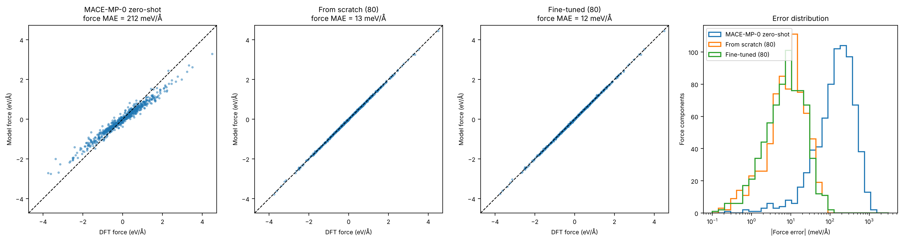
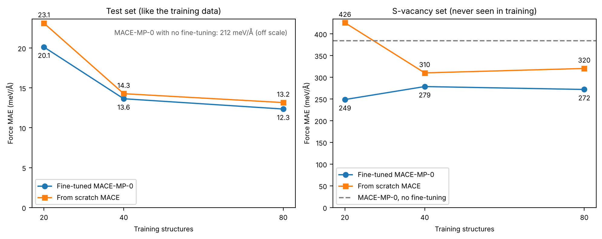
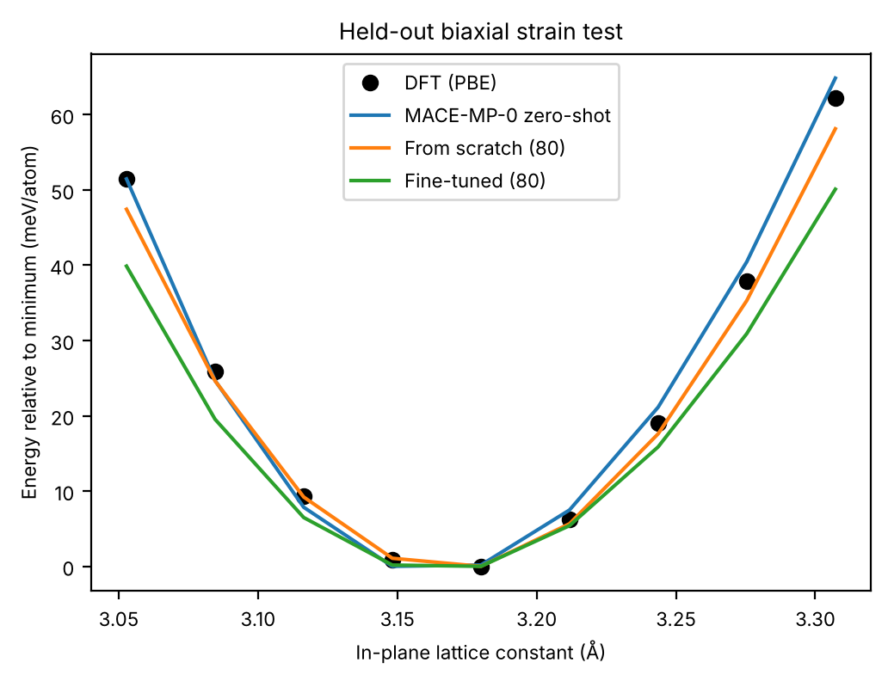
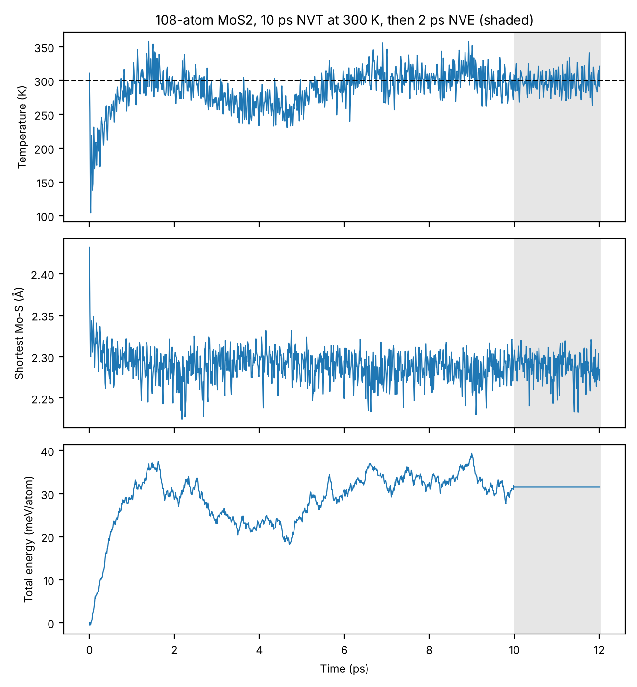

# Fine-Tuning MACE-MP-0 for Monolayer MoS₂

Fine-tuning the MACE-MP-0 foundation model on new PBE data for monolayer MoS₂, compared with the model before fine-tuning and with a MACE model trained from scratch.

Hamdan Ashfaq · PhD student, Computational Science, San Diego State University and UC Irvine



## Summary

* 157 DFT calculations (GPAW, PBE): 119 pristine monolayer cells (strained, rattled, and MD snapshots at 300 to 900 K) and 38 cells with a sulfur vacancy.
* Fine-tuning on 80 structures lowers the test force error from 212 to 12 meV/Å and the energy error from 12.2 to 0.8 meV/atom.
* A model trained from scratch on the same data reaches 13 meV/Å, but transfers worse to vacancies.
* No model trained only on pristine cells handles vacancies. Adding 26 vacancy structures lowers the vacancy error from 272 to 40 meV/Å.
* The fine-tuned model runs stable MD on a 108-atom cell for 12 ps.

## Method

1. **Structures** ([`01_make_structures.py`](scripts/01_make_structures.py)). 2×2 supercells (12 atoms, about 14 Å of vacuum): 9 under biaxial strain from −4% to +4%, 50 with random strain and atomic displacements, and 60 MD snapshots at 300, 600 and 900 K from MACE-MP-0.
2. **DFT** ([`02_run_dft.py`](scripts/02_run_dft.py), [`dft.py`](scripts/dft.py)). GPAW, PBE, 400 eV plane-wave cutoff, 4×4×1 k-points, 0.05 eV Fermi-Dirac smearing. Convergence is checked in [`00_convergence.py`](scripts/00_convergence.py).
3. **Vacancies** ([`03_vacancy_data.py`](scripts/03_vacancy_data.py)). One S atom removed. 12 cells for testing, 26 for training.
4. **Split** ([`04_split_data.py`](scripts/04_split_data.py)). The strain series is held out. The other 110 cells are split 80 / 10 / 20 into train, validation and test, with 20 and 40 structure subsets for the learning curve.
5. **Training** ([`05_finetune.sh`](scripts/05_finetune.sh), [`06_train_from_scratch.sh`](scripts/06_train_from_scratch.sh)). MACE-MP-0 small (128 channels, L = 0, 6 Å cutoff) fine-tuned for 150 epochs. The baseline uses the same architecture from random weights for 300 epochs. Both ran on CPU in float64.
6. **Evaluation and MD** ([`07_evaluate.py`](scripts/07_evaluate.py), [`08_md_stability.py`](scripts/08_md_stability.py)).

## Results

All errors are on structures no model was trained on ([`results/metrics.json`](results/metrics.json)).

| Model | Training structures | Energy MAE (meV/atom) | Force MAE (meV/Å) | Force RMSE (meV/Å) | Vacancy force MAE (meV/Å) |
|---|---:|---:|---:|---:|---:|
| MACE-MP-0, no fine-tuning (zero-shot) | 0 | 12.2 | 212.3 | 286.5 | 383.9 |
| From scratch | 20 | 3.8 | 23.1 | 34.6 | 425.6 |
| From scratch | 40 | 0.5 | 14.3 | 21.6 | 310.1 |
| From scratch | 80 | 0.4 | 13.2 | 18.8 | 320.2 |
| Fine-tuned | 20 | 5.0 | 20.1 | 28.7 | 248.6 |
| Fine-tuned | 40 | 0.5 | 13.6 | 19.9 | 278.5 |
| Fine-tuned | 80 | 0.8 | 12.3 | 18.8 | 271.9 |
| Fine-tuned + vacancies | 80 + 26 | 0.8 | 14.0 | 20.1 | 39.9 |

The average DFT force component in the test set is 0.74 eV/Å.



* Before fine-tuning, MACE-MP-0 gets the force directions right but the magnitudes about 25% too small (slope 0.74 against DFT), the softening described by Deng et al.
* On structures like the training data, fine-tuning beats training from scratch by 0.7 to 3 meV/Å.
* On vacancies, fine-tuned models are 30 to 180 meV/Å better than models trained from scratch. In a 2×2 cell the vacancy neighbors 3 of the 4 Mo atoms, so every model is far outside its training data.
* With 26 vacancy structures added, the vacancy error falls to 40 meV/Å and the pristine error rises from 12.3 to 14.0 meV/Å.

### Strain test



| | DFT | No fine-tuning | From scratch (80) | Fine-tuned (80) | Fine-tuned + vacancies |
|---|---:|---:|---:|---:|---:|
| Curve minimum (Å) | 3.168 | 3.164 | 3.169 | 3.165 | 3.164 |
| Curve RMSE (meV/atom) | | 1.5 | 1.6 | 4.3 | 5.4 |

All models find the minimum within 0.004 Å of DFT, but the fine-tuned models are too soft at large strain (about 50 meV/atom at +4% against 62 from DFT). Training only covered ±3% strain mixed with atomic displacements.

### MD stability



| 108 atoms, fine-tuned model | |
|---|---|
| Mean temperature, last 5 ps | 300.3 K |
| Shortest Mo-S distance | 2.22 Å (2.43 Å at the start) |
| NVE energy drift | 3 × 10⁻⁵ meV/atom per ps |

The dip in temperature at the start comes from starting at a perfect lattice. The flat total energy in the NVE window shows the forces are consistent with the energies.

## Convergence and limitations

Measured on a rattled cell against 600 eV and 6×6×1 k-points ([`results/convergence.json`](results/convergence.json)):

| Setting | Energy difference (meV/atom) | Largest force difference (meV/Å) |
|---|---:|---:|
| 300 eV | 91.6 | 28.0 |
| 400 eV (used) | 16.3 | 7.0 |
| 500 eV | 3.5 | 0.4 |
| 3×3×1 k-points | 0.4 | 13.4 |
| 4×4×1 k-points (used) | 0.0 | 1.1 |

The 16 meV/atom offset at 400 eV is nearly constant across structures and cancels in relative energies. The force difference is below the model error.

* Small dataset of one material, all in 11 or 12 atom cells.
* No spin polarization, spin-orbit coupling or van der Waals correction.
* GPAW and MACE-MP-0 use different energy zero points, so model energies are shifted by a constant fitted on the training set. Vacancy cells have a different composition, so only their forces are compared.
* The strained cells are not relaxed, so the curve minimum is not the relaxed PBE lattice constant (about 3.18 Å).

Next: add strained and larger cells to training, try multi-head fine-tuning to keep more of the pretrained model, and extend to other defects and twisted bilayers.

## Usage

```bash
git clone https://github.com/hamdanashfaq63/mos2-mace-finetuning.git
cd mos2-mace-finetuning
pip install -r requirements.txt
```

```python
from ase.build import mx2
from mace.calculators import MACECalculator

atoms = mx2("MoS2", "2H", a=3.18, vacuum=7.0).repeat((4, 4, 1))
atoms.calc = MACECalculator(model_paths="models/mos2_finetuned.model", device="cpu")
print(atoms.get_potential_energy())
```

To rerun everything from the repository root (GPAW also needs libxc, BLAS and its PAW datasets):

```bash
python scripts/00_convergence.py
python scripts/01_make_structures.py
python scripts/02_run_dft.py
python scripts/03_vacancy_data.py
python scripts/04_split_data.py
bash scripts/05_finetune.sh
bash scripts/05_finetune.sh mos2_finetuned_20 data/train_20.xyz
bash scripts/05_finetune.sh mos2_finetuned_40 data/train_40.xyz
bash scripts/05_finetune.sh mos2_finetuned_vacancy data/train_plus_vacancy.xyz
bash scripts/06_train_from_scratch.sh
bash scripts/06_train_from_scratch.sh mos2_from_scratch_20 data/train_20.xyz
bash scripts/06_train_from_scratch.sh mos2_from_scratch_40 data/train_40.xyz
python scripts/07_evaluate.py
python scripts/08_md_stability.py
```

Versions: GPAW 26.7 (PAW datasets 24.1), ASE 3.29, MACE 0.3.16, PyTorch 2.14.

## Repository layout

```
├── scripts/    structure generation, DFT, training, evaluation, MD
├── data/       structures and DFT labels (extended XYZ: REF_energy in eV, REF_forces in eV/Å)
├── models/     trained MACE models
└── results/    metrics, figures, convergence data, logs
```

## References

* I. Batatia, D. P. Kovács, G. N. C. Simm, C. Ortner and G. Csányi, "MACE: Higher order equivariant message passing neural networks for fast and accurate force fields," NeurIPS 2022.
* I. Batatia et al., "A foundation model for atomistic materials chemistry," arXiv:2401.00096.
* B. Deng et al., "Overcoming systematic softening in universal machine learning interatomic potentials by fine-tuning," arXiv:2405.07105.
* J. J. Mortensen et al., "GPAW: An open Python package for electronic structure calculations," J. Chem. Phys. 160, 092503 (2024).

## License

MIT. The DFT data in `data/` is free to reuse.
